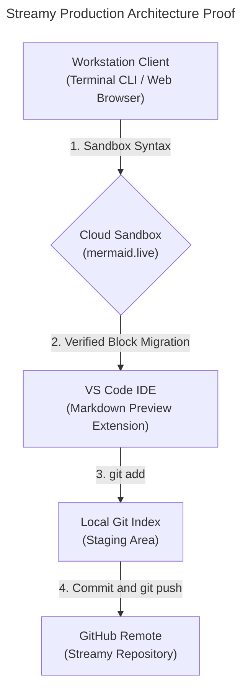
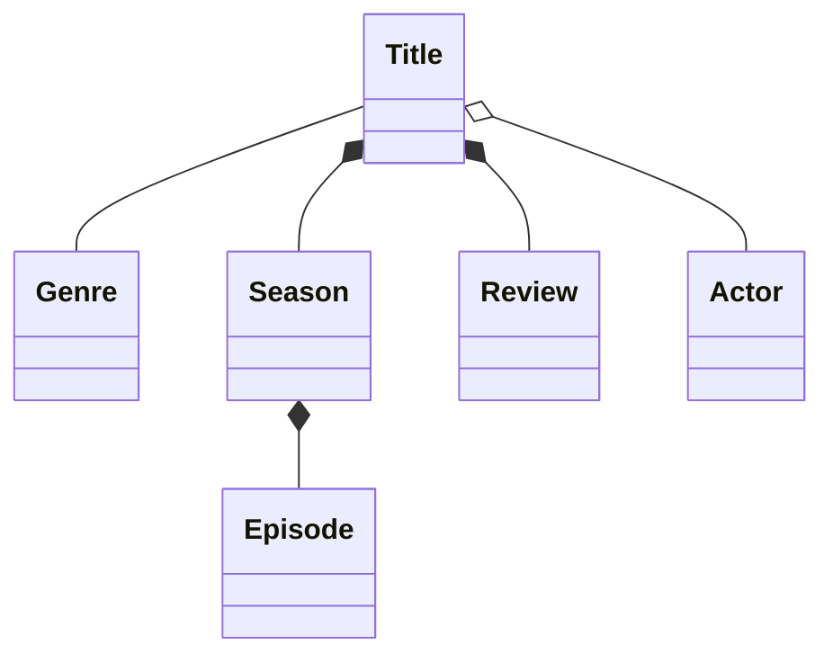
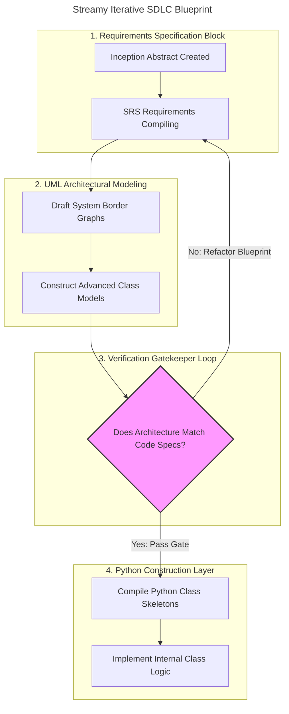
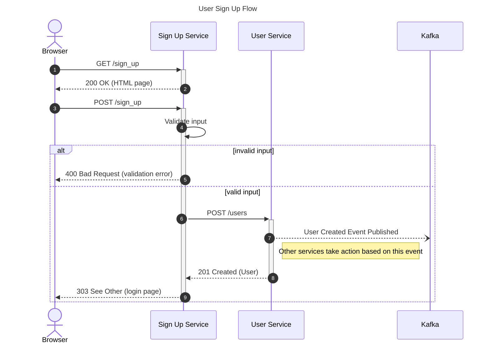

# Streamy Video Streaming Backend Platform

## Software Technology Course Laboratory Node
- **Student Identity:** Ali Asgarov
- **Neptun System Code:** KXVFXM
- **Course Section Reference:** GEIAL314-B2a
- **Instructor:** Dr. Jawad Alshboul

## Workspace Environment Architecture
The diagram maps local authoring, syntax validation and remote version control using a Diagrams-as-Code workflow.

## Lab 1 Extra: Domain Relationships
Association connects independently existing entities. Composition represents exclusive ownership and a dependent lifecycle. Aggregation groups independent entities.

## Streamy Application Engineering Development Lifecycle
The project follows an iterative review process: specification, UML design, validation and Python implementation. A failed validation returns to the requirements stage. The implementation stages describe future work.

## Lab 3 Extra: User Sign Up Sequence
This illustrative service interaction covers numbered messages, activation lifelines, validation branches, synchronous responses and an asynchronous Kafka event. The repository menu link is an example placeholder. The sign-up service remains active through both branches and deactivates after the alternative block.

## Lab Deliverables
- [Project inception and enhanced UML domain model](abstract.md) — Lab 2.
- [Software requirements and C4 context](SRS.md) — Lab 4.
- [Sprint workflow, task tracing and C4 containers](sprint_architecture.md) — Lab 5.
- This README contains the Lab 1 environment and domain model plus the Lab 3 lifecycle and sequence diagram.

## Technical Clarifications
- Git stores snapshots in a commit graph. Author identity is metadata; it is not a cryptographic signature.
- Mermaid inheritance uses `--|>`; directional associations use `-->`.
- Subgraph identifiers cannot contain unquoted spaces; display labels may contain spaces.
- The sequence example uses a temporary `303` redirect after POST and balances activations across both branches.
- Mermaid links may be disabled by a renderer's security configuration.
- Lab 4's boundary example labels playback as FR-2, but its written FR-2 specifies seasons. SRS.md uses the written FR-1 through FR-5 consistently; actual video delivery stays outside the Python backend.
