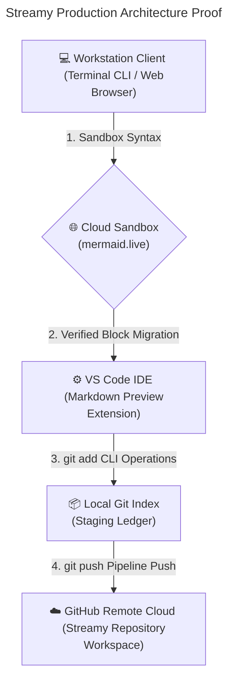
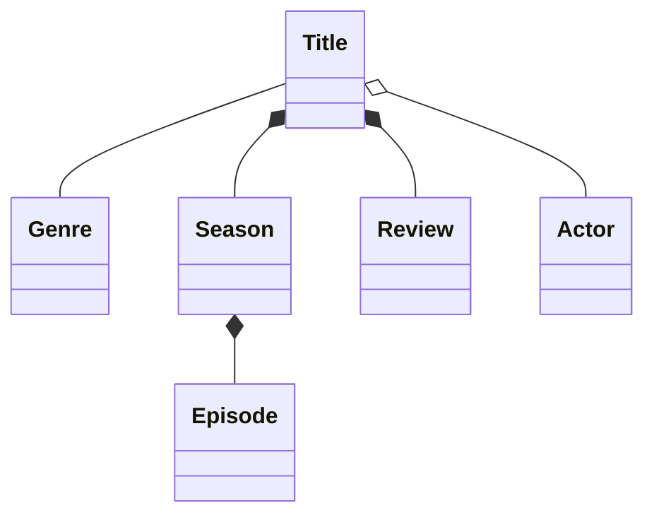
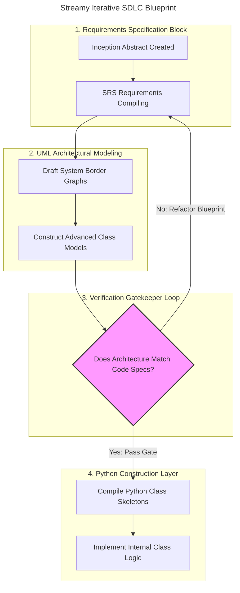
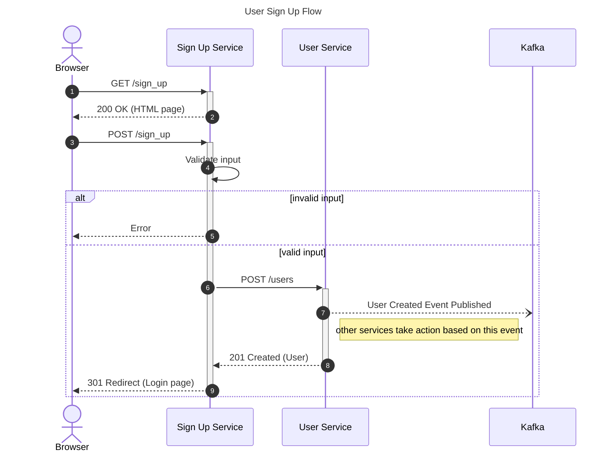

# Streamy Video Streaming Backend Platform

## Software Technology Course Laboratory Node
* **Student Identity:** Ali Asgarov
* **Neptun System Code:** KXVFXM
* **Course Section Reference:** GEIAL314-B2a

---

## Workspace Environment Architecture
The diagram below maps out how our development environment connects local code
authoring to remote version tracking, using a **Diagrams-as-Code** design pipeline.

## Lab 1 Extra Mermaid: Document Your Domain (UML Class Diagrams)

## Streamy Application Engineering Development Lifecycle
To guarantee systematic software tracking across the implementation lifespan of
**Streamy**, our individual developer pipeline follows the structured iterative gate
review framework illustrated below.

## Lab 3 Extra: Visualize Application and User Flows (Sequence Diagrams)

