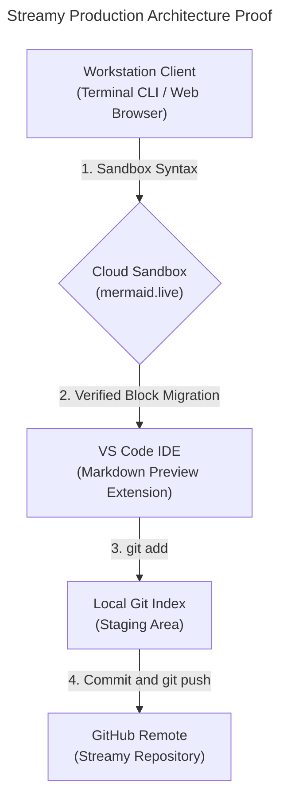
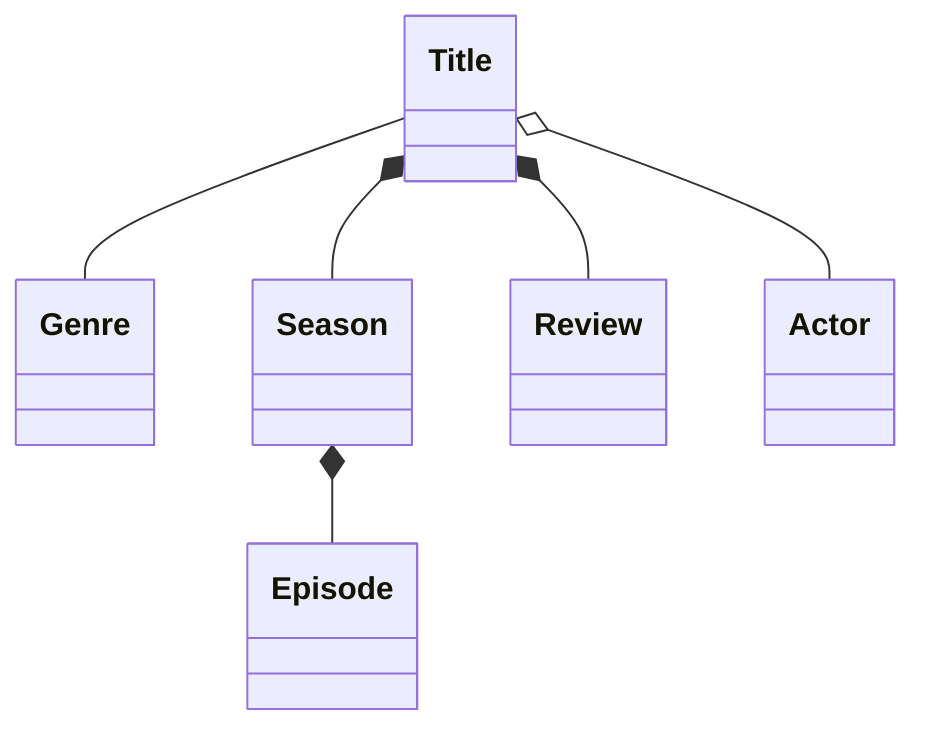

# Streamy Video Streaming Backend Platform

## Software Technology Course Laboratory Node
- **Student Identity:** Ali Asgarov
- **Neptun System Code:** KXVFXM
- **Course Section Reference:** GEIAL314-B2a
- **Instructor:** Dr. Jawad Alshboul

## Workspace Environment Architecture
The diagram maps local authoring, syntax validation and remote version control using a Diagrams-as-Code workflow.

## Lab 1 Extra: Domain Relationships
Association connects independently existing entities. Composition represents exclusive ownership and a dependent lifecycle. Aggregation groups independent entities.

