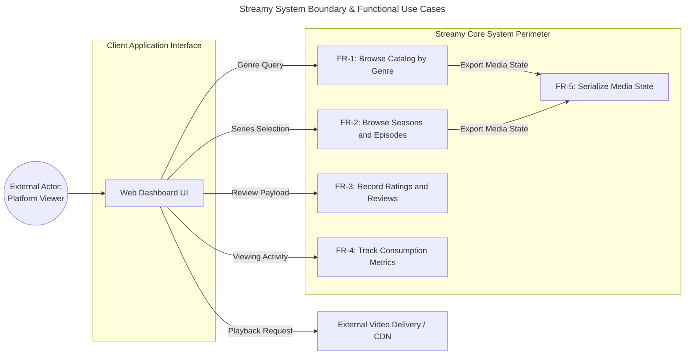
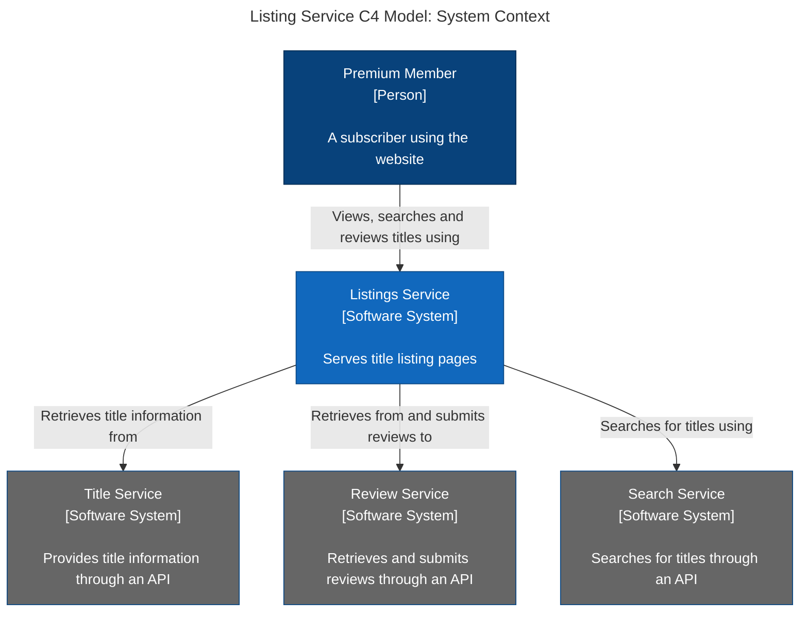

# Software Requirements Specification (SRS)
## Project Baseline: Streamy Video Streaming Core Engine

**Author:** Ali Asgarov | **Neptun:** KXVFXM | **Course:** GEIAL314-B2a

### 1. Functional Requirements (FR)
- **FR-1:** The system must maintain a media catalog searchable by Genre.
- **FR-2:** The system must support multi-season episodic indexing for TVShow entities.
- **FR-3:** The system must allow users to record numerical ratings and text reviews against media elements.
- **FR-4:** The system must track viewer consumption metrics for metadata analytics.
- **FR-5:** The system must support serialization of media-item state, including inherited subtype information.

### 2. Non-Functional Requirements (NFR)
- **NFR-1 (Runtime environment):** The application must run in Python 3.x.
- **NFR-2 (Maintainability):** Design diagrams, relationship maps and entity models must be stored as plain text and rendered inline.
- **NFR-3 (Data integrity):** Deletion must cascade through composed child entities. Independent genres and actors must survive deletion of an associated title.

### 3. Functional System Boundary Diagram
The backend processes metadata and domain operations. A client requests actual video content from external delivery infrastructure. The FR identifiers below match Section 1.

### 4. Acceptance Criteria
| Requirement | Observable completion condition |
| --- | --- |
| FR-1 | A genre query returns matching titles; a genre with no matches returns an empty collection. |
| FR-2 | A television show exposes its ordered seasons and each season's episodes. |
| FR-3 | A review stores a numeric rating and text with exactly one media owner. |
| FR-4 | A viewing event can be attributed to a viewer and a media item for later aggregation. |
| FR-5 | Serialized data preserves the media type and both shared and subtype fields. |
| NFR-1 | The implemented application runs under Python 3.x. |
| NFR-2 | Repository Markdown renders all Mermaid diagrams. |
| NFR-3 | Removing a title removes its composed descendants, while actors and genres remain. |

These are future implementation acceptance criteria, not claims that application tests have already passed. Rating bounds, persistence technology and metric retention remain design decisions for later implementation.

## Lab 4 Extra: C4 System Context
A premium member uses the Listings Service, which depends on title, review and search services. This is a conceptual service-level context view; these labs do not deploy those services.

