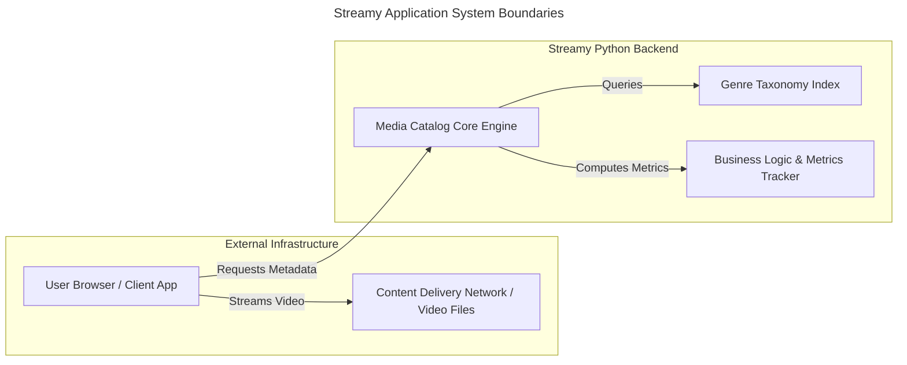
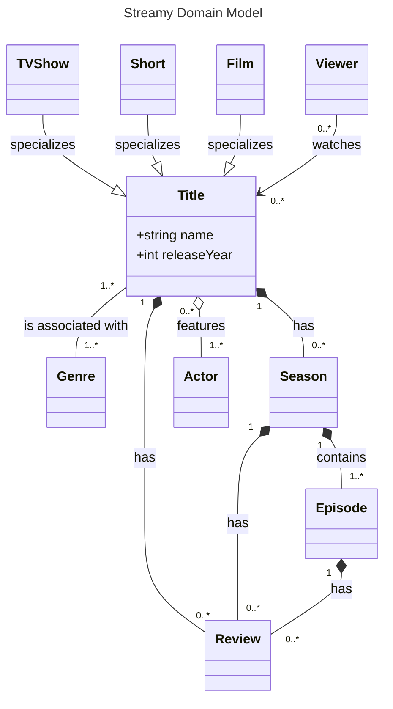

# Streamy Video Streaming Backend Platform
## Project Inception and Structural System Abstract

**Author:** Ali Asgarov | **Neptun:** KXVFXM

### 1. Architectural Core Objectives
Streamy is an object-oriented backend media management catalog designed to serve as the core engine for an enterprise digital video streaming marketplace. The application tracks, structures, and processes relationships between media formats, classification taxonomies, and user metric collections.

### 2. Primary System Boundaries
The Python backend manages catalog metadata, genres, domain relationships, reviews and consumption metrics. Browser interfaces, video storage and delivery through a CDN are external. These labs specify and model the system; implementation of a working streaming service is outside their scope.

### 3. Core Structural Domain Entities
1. **Title:** The central media class holding names, release dates and shared metadata for films, short films and television series.
2. **Genre:** A classification category such as Sci-Fi, Drama or Documentary. Titles and genres form a many-to-many relationship.

## Lab 2 Extra: Enhanced Domain Model
The model adds inheritance, relationship labels, multiplicities and a clickable example link. `--|>` denotes inheritance; `-->` denotes a navigable association. The example link is a placeholder, not an implemented service.

**Model constraints:** Only TVShow instances may own seasons; Film and Short have none. Each Review belongs to exactly one reviewed object (a Title, Season, or Episode), never all three simultaneously. Deleting an owner deletes its composed children; associated genres and aggregated actors remain independent. Title attributes and top-down direction provide spacing instead of artificial blank attributes.
