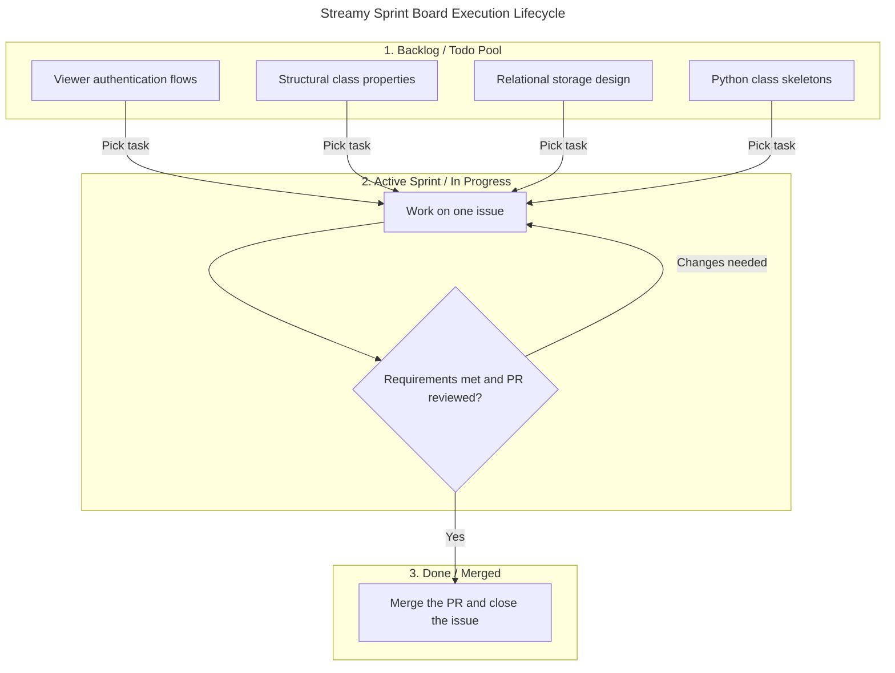
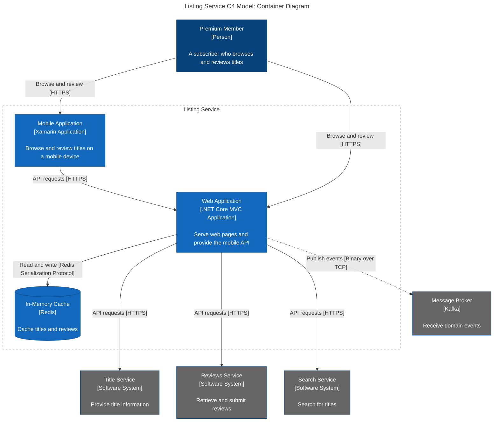

# Streamy Sprint Management

**Ali Asgarov | KXVFXM | GEIAL314-B2a**

This sprint tracks the next design and implementation tasks. Each issue has a requirement reference and a checklist. The board uses **Todo**, **In Progress** and **Done**. Only one task should be in progress at a time.

[Open the Streamy Development Sprint Board](https://github.com/users/aliasgarov007-dot/projects/1)

## Sprint workflow

All four issues start in Todo. The authentication interaction task is then moved to In Progress. An issue moves to Done after its work has been checked and merged; creating an issue does not complete its implementation.

## Requirement tracing

| Task | Requirement | Expected work | Lab 5 status |
| --- | --- | --- | --- |
| [#4 Viewer authentication flows](https://github.com/aliasgarov007-dot/Streamy-Software-Technology/issues/4) | Supports viewer identification for FR-4; see note below | Sign-up/login sequences and error branches in `interactions.md` | In Progress |
| [#5 Structural class properties](https://github.com/aliasgarov007-dot/Streamy-Software-Technology/issues/5) | FR-1, FR-2, FR-5 | Attributes, methods, inheritance and multiplicities | Todo |
| [#6 Relational storage design](https://github.com/aliasgarov007-dot/Streamy-Software-Technology/issues/6) | NFR-3 | ER diagram with PKs, FKs and deletion rules | Todo |
| [#7 Python class skeletons](https://github.com/aliasgarov007-dot/Streamy-Software-Technology/issues/7) | NFR-1 | `streamy_core.py`, based on the reviewed model and Lab 7 specification | Todo |

The Lab 5 handout traces authentication directly to FR-4. In the existing [SRS](SRS.md), FR-4 is consumption tracking. Authentication can support identifying a viewer, but it is a separate concern and does not satisfy FR-4 on its own. The existing FR-4 has therefore not been renamed. The Lab 7 specification must be reviewed before implementing the Python skeleton task.

The [README](README.md) already has an introductory sign-up sequence, and [abstract.md](abstract.md) has a domain model. The new issues extend those examples rather than treating the later tasks as complete.

## Lab 5 Extra: C4 Container Diagram

This expands the Listings Service context from Lab 4. A container is a deployable application or data store, not necessarily a Docker container. The .NET and Xamarin labels follow the handout's example. They describe this separate Listings Service exercise, not a replacement for the Python core required by NFR-1. No services are deployed in this lab.

The cache is inside the dashed system boundary. The Kafka edge represents asynchronous publication; the service API edges are solid. Longer API arrows separate the supporting systems from the internal containers.
